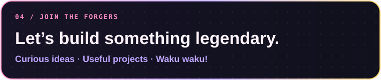

<b><a href="https://github.com/Sneha21-09">GITHUB · @Sneha21-09</a></b> &nbsp; ✦ &nbsp; VIT VELLORE &nbsp; ✦ &nbsp; B.TECH DATA SCIENCE &nbsp; ✦ &nbsp; 3RD YEAR · SEMESTER 5

*“Waku waku! Turning curiosity into code, and data into insights.”*

---

## 🌸 About Sneha

## ✨ Skill Constellation

Technology names are grounded in the visible public repository descriptions and language labels; this is not a claim of expert-level proficiency.

## 🪪 Developer ID & Power Level Dashboard

## 🚀 Featured Missions

## 🗂️ Repository Collection

**14 public repositories · 2 project lanes · one growing portfolio.** Select any illustrated card to open its GitHub repository. The collection is designed so new projects can be added as matching cards later.

### 🧠 Data, AI, Research & Spatial Intelligence

<table>
<tr><td width="50%" align="center"></td><td width="50%" align="center"></td></tr>
<tr><td width="50%" align="center"></td><td width="50%" align="center"></td></tr>
<tr><td width="50%" align="center"></td><td width="50%" align="center"></td></tr>
<tr><td width="50%" align="center"></td><td width="50%" align="center"></td></tr>
<tr><td width="50%" align="center"></td><td width="50%" align="center"></td></tr>
<tr><td width="50%" align="center"></td><td width="50%" align="center"></td></tr>
<tr><td width="50%" align="center"></td><td width="50%" align="center"></td></tr>
</table>

### 💻 Web Development & Digital Builds

|  |  |
| --- | --- |

<a href="https://github.com/Sneha21-09?tab=repositories"><b>✦ Explore all repositories on GitHub →</b></a>

New project? Duplicate any SVG in <code>repo-cards/</code>, update its title, description, accent and tags, then add its linked image to this two-column grid. Keep the project count in the dashboard in sync with the public profile.

## 🌃 Contribution Skyline

Generated by the repository's GitHub Actions workflow. It updates on schedule after the workflow runs successfully.

## 💌 Connect

<table width="100%">
<tr>
<td width="38%" align="center" valign="middle">

</td>
<td width="62%" valign="middle">

 

</td>
</tr>
</table>

**Code · Learn · Create · Grow**  
*“Waku waku! Keep learning, keep building!”* 💗

