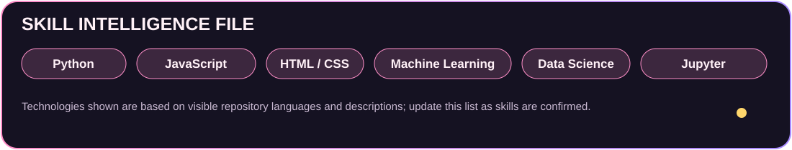

### Data Science Student · AI & ML Enthusiast · Developer

**VIT Vellore · B.Tech Data Science · 3rd Year · 5th Semester**

*“Waku waku! Turning curiosity into code, and data into insights.”*

---

## 🕵️ About Me

Hey there! I'm **Sneha**, a B.Tech Data Science student at **VIT Vellore**. I'm interested in exploring data, building intelligent solutions and developing useful software. My public repositories cover machine learning, data drift analysis, air intelligence, GIS and web development.

- 🎓 B.Tech in Data Science — VIT Vellore
- 📚 3rd Year · 5th Semester
- 🤖 Interested in AI, Machine Learning and Data Science
- 💻 Building projects across analytics and web development
- 🌱 Learning by experimenting, building and improving

## ✨ Skill Intelligence File

**Technologies evidenced in the visible repository descriptions/language labels:** Python, JavaScript, HTML, CSS, Node.js, Express.js, MongoDB, FastAPI, Jupyter Notebook, QGIS/GIS, PSI and statistical drift analysis. This list is intentionally limited to what is visible in the profile screenshots; it can be expanded when Sneha confirms additional skills.

---

## 🚀 Featured Missions

All **14 public repositories** visible on Sneha's profile are included below. Each project title links directly to its repository.

### 🧠 AI, Machine Learning & Data Science

| Mission | Brief | Stack / Focus |
|---|---|---|
| [Driftuara](https://github.com/Sneha21-09/Driftuara) | Explainable ML drift intelligence using PSI, chi-square analysis and interactive dashboards. | PSI · FastAPI · ML |
| [RockSafeAIProject](https://github.com/Sneha21-09/RockSafeAIProject) | AI early-warning for open-pit mine rockfall risk using micro-vibration and acoustic patterns. | Jupyter · AI |
| [RockSafeAI_Prototype](https://github.com/Sneha21-09/RockSafeAI_Prototype) | LSTM-based rockfall risk prototype using vibration/acoustic time-series. | Python · LSTM |
| [psi-multicolumn-drift-detection](https://github.com/Sneha21-09/psi-multicolumn-drift-detection) | Multi-column drift analysis with PSI, mean/variance shift, T-test and F-test. | Statistics · PSI |
| [psi_early_warning_system](https://github.com/Sneha21-09/psi_early_warning_system) | Single-column numerical drift early-warning with PSI and KL divergence. | Statistics · PSI |
| [PRISM_GENAI_HACKATHON_2026](https://github.com/Sneha21-09/PRISM_GENAI_HACKATHON_2026) | GenAI hackathon project repository. | JavaScript |
| [GIS-Land-Suitability-Analysis](https://github.com/Sneha21-09/GIS-Land-Suitability-Analysis) | QGIS raster/vector analysis and land-suitability mapping for Varanasi. | QGIS · GIS |
| [VayuNetra](https://github.com/Sneha21-09/VayuNetra) | Hyperlocal Air Intelligence & Enforcement Platform. | JavaScript |

### 💻 Web Development & Applications

| Mission | Brief | Stack / Focus |
|---|---|---|
| [StudentTaskTracker](https://github.com/Sneha21-09/StudentTaskTracker) | Full-stack task and assignment tracker with JWT authentication. | HTML · CSS · JS · Node · Express · MongoDB |
| [portfolio](https://github.com/Sneha21-09/portfolio) | Responsive personal portfolio for projects, research, skills and achievements. | HTML |
| [Frontend-Calculator](https://github.com/Sneha21-09/Frontend-Calculator) | Multi-page calculator with landing, login and registration pages. | HTML · CSS · JavaScript |
| [VIT-Web-clone-using-HTML-CSS](https://github.com/Sneha21-09/VIT-Web-clone-using-HTML-CSS) | Campus-tour website with images, logos and embedded video. | HTML · CSS |
| [mini-project1-css-](https://github.com/Sneha21-09/mini-project1-css-) | First mini project focused on CSS. | CSS |
| [My-First-Portfolio](https://github.com/Sneha21-09/My-First-Portfolio) | Personal portfolio starter project. | HTML |

📌 Pinned external repository shown on the GitHub profile

[HFT-COMPILER-FRAMEWORK](https://github.com/devinasharma094/HFT-COMPILER-FRAMEWORK) appears among the pinned repositories, but its owner is `devinasharma094`, so it is listed separately and is not counted among Sneha's 14 owned public repositories.

---

## 📊 GitHub Intelligence

## 🌸 Contribution Skyline

---

## 💌 Connect

*LinkedIn and public email are not displayed until Sneha shares the exact public URLs.*

**Code · Learn · Create · Grow**

*“Waku waku! Keep learning, keep building!”* 💗

